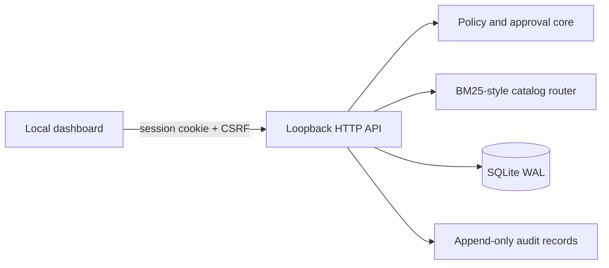

# Architecture

The server binds to `127.0.0.1` and accepts only `localhost:<configured-port>` or `127.0.0.1:<configured-port>` Host values. Dashboard data requests require a cookie from the one-time token exchange. Mutations require a CSRF header; cross-origin requests are rejected. Collection endpoints are capped at 250 records and sorted by indexed timestamps where applicable.

The router ranks local agent/tool/skill descriptions using normalized token overlap. It returns catalog IDs only and caps selected tools at 15. It is a deterministic retrieval baseline, not a model router or fine-tuned model.

SQLite stores runs, catalogs, approvals, tasks, memories, proposals, settings, and audit entries. The only current run implementation records routing/context and a mock response; no tools execute.
